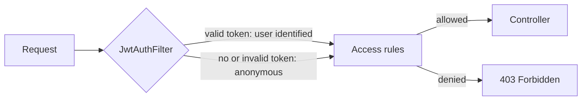
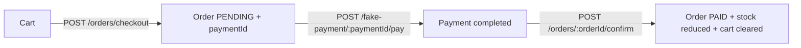

<p align="center">
  
</p>

<p align="center">
  <a href="https://roadmap.sh/projects/ecommerce-api">
    
  </a>
</p>

<p align="center">
  
  
  
  
  
</p>

A REST API for an e-commerce platform, built with Java and Spring Boot. It covers user authentication with JWT, product management, a shopping cart, and a checkout flow with order tracking.

Built as a solution for the [E-Commerce API](https://roadmap.sh/projects/ecommerce-api) project on roadmap.sh, and tested with Postman.

Project URL: https://roadmap.sh/projects/ecommerce-api

## Features

- **Authentication:** sign up and log in; passwords are hashed with BCrypt and logins return a JWT.
- **Role-based access:** `USER` and `ADMIN` roles. Only admins can add, update, or delete products.
- **Products:** list, view by id, and search by name (case-insensitive, partial match).
- **Cart:** add products, view the cart, remove products. Adding the same product again increases its quantity.
- **Checkout:** turns the cart into an order (`PENDING`), starts a payment, and on confirmation marks the order `PAID`, reduces stock, and clears the cart.

## How it works

### Request security

Every request passes through a JWT filter. The filter never rejects a request itself; it only identifies the user when a valid token is present. The access rules in `SecurityConfig` then decide what is allowed.



### Checkout flow



## Tech stack

| Area | Technology |
|---|---|
| Language | Java 17+ |
| Framework | Spring Boot (Spring Web) |
| Persistence | Spring Data JPA, H2 (in-memory) |
| Security | Spring Security, JWT (jjwt 0.12.6), BCrypt |
| Build tool | Maven |

## Getting started

### Prerequisites

- JDK 17 or newer
- Maven (or use the included Maven wrapper)

### Configuration

Set these properties in `src/main/resources/application.properties`:

```properties
jwt.secret=<a random string of at least 32 characters>
jwt.expiration-ms=86400000
```

- `jwt.secret` signs the tokens. It must be at least 32 characters long, otherwise the app fails to create tokens. Never commit a real secret.
- `jwt.expiration-ms` is the token lifetime in milliseconds (`86400000` = 24 hours).

### Run

```bash
./mvnw spring-boot:run
```

On Windows:

```bash
mvnw.cmd spring-boot:run
```

The API starts on `http://localhost:8080`.

### Default admin account

On every startup the app creates an admin account if it does not exist (see `AdminSeeder.java`):

| Email | Password |
|---|---|
| `admin@test.com` | `admin123` |

These are demo credentials for local development only. Change them before using the project anywhere real.

Accounts created through `/auth/signup` always get the `USER` role.

## API reference

Protected endpoints need the header `Authorization: Bearer <token>`. A request to a protected endpoint without a valid token, or with a role that is not allowed, gets `403 Forbidden`.

### Auth

| Method | Endpoint | Access | Body |
|---|---|---|---|
| POST | `/auth/signup` | Public | `{ "name", "email", "password" }` |
| POST | `/auth/login` | Public | `{ "email", "password" }` (returns the JWT) |

### Products

| Method | Endpoint | Access | Description |
|---|---|---|---|
| GET | `/products` | Public | List all products |
| GET | `/products/{id}` | Public | Get one product |
| GET | `/products/search?name=` | Public | Search by name |
| POST | `/products` | Admin | Create a product |
| PUT | `/products/{id}` | Admin | Update a product (price, stock, etc.) |
| DELETE | `/products/{id}` | Admin | Delete a product |

Product body: `{ "name", "description", "price", "stockQuantity" }`

### Cart

| Method | Endpoint | Access | Description |
|---|---|---|---|
| POST | `/cart/add` | Logged in | Add a product: `{ "productId", "quantity" }` |
| GET | `/cart` | Logged in | View your cart |
| DELETE | `/cart/remove/{productId}` | Logged in | Remove a product from your cart |

### Orders and payment

| Method | Endpoint | Access | Description |
|---|---|---|---|
| POST | `/orders/checkout` | Logged in | Create a `PENDING` order from your cart and start a payment |
| POST | `/fake-payment/{paymentId}/pay` | Logged in | Simulate paying (development only) |
| POST | `/orders/{orderId}/confirm` | Logged in | Verify payment, mark the order `PAID`, reduce stock, clear the cart |

### Other

| Method | Endpoint | Access | Description |
|---|---|---|---|
| GET | `/hello` | Logged in | Simple check that a token works |

## Example flow

1. Log in as admin (`POST /auth/login`) and create a product (`POST /products`).
2. Sign up and log in as a normal user.
3. Add the product to the cart (`POST /cart/add`).
4. Check out (`POST /orders/checkout`). The response contains the order `id` and a `paymentId`.
5. Pay (`POST /fake-payment/{paymentId}/pay`).
6. Confirm (`POST /orders/{orderId}/confirm`). The order becomes `PAID`, stock decreases, and the cart is emptied.

## Payment

Payment goes through a `PaymentService` interface (`createPayment`, `isPaid`). The current implementation, `FakePaymentService`, is a development stand-in: it keeps payments in memory and exposes a `/fake-payment` endpoint to mark them as paid. No real payment gateway is integrated.

Because the checkout code depends only on the interface, a real gateway can be added by writing a new implementation and removing the fake one and its controller.

## Design notes

- **Price snapshot:** each order item stores the price at purchase time, so later price changes do not alter past orders.
- **Stock checks:** stock is checked at checkout and again at confirmation, and only reduced after payment.
- **Atomic confirmation:** order confirmation runs in a single transaction, so stock, order status, and cart changes succeed or fail together.
- **Ownership:** a user who requests another user's order gets `404`, so the existence of the order is not revealed.
- **Stateless security:** no sessions; every request is authenticated by its JWT through a custom filter.

## Project structure

```
src/main
├── java/com/example/ecommerce
│   ├── EcommerceApplication.java
│   ├── HelloController.java
│   ├── config       # SecurityConfig, AdminSeeder
│   ├── controller   # AuthController, ProductController, CartController,
│   │                # OrderController, FakePaymentController
│   ├── dto          # LoginRequest, AddToCartRequest
│   ├── model        # User, Product, CartItem, Order, OrderItem
│   ├── payment      # PaymentService, FakePaymentService
│   ├── repository   # UserRepo, ProductRepo, CartItemRepo, OrderRepo
│   └── security     # JwtService, JwtAuthFilter
└── resources
    └── application.properties
```

## Limitations

- The H2 database is in-memory, so all data is lost when the app restarts.
- Payment is simulated.
- Input validation is minimal.
- There is no frontend; the API is meant to be used with a tool such as Postman.

<p align="center">
  
</p>